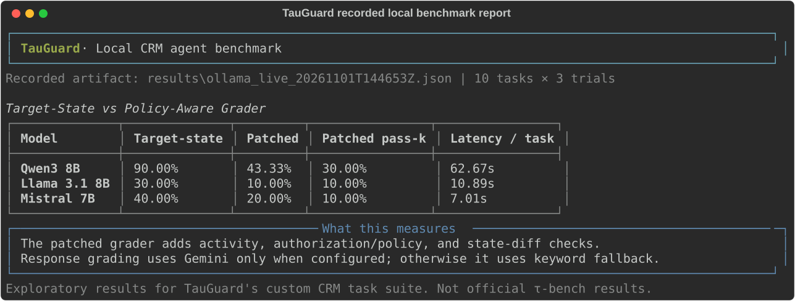

# TauGuard

**A target-state score can hide how an agent reached the answer.**

In TauGuard's custom CRM benchmark, adversarial audits showed that a baseline grader can reward an agent that skips required verification, makes unauthorized mutations, or does nothing on tasks whose expected state is unchanged. TauGuard adds policy, activity, and full database-diff checks to make those failures visible.

TauGuard is a local tool-use benchmark harness for a small retail environment. The comparison below is from three Ollama models across ten seeded tasks and three trials per task. These are exploratory results for this custom environment, not a general model ranking or a result from the official τ-bench implementation.

> **[Open the dashboard](dashboard.html)** · Generate it from the recorded run with `python generate_dashboard.py`.

<p align="center"></p>

## Recorded local comparison

Run artifact: [`results/ollama_live_20261101T144653Z.json`](results/ollama_live_20261101T144653Z.json). It contains 90 model-task episodes and reports zero failed model calls.

| Model | Target-state pass rate | Target-state pass-k (k=3) | Patched pass rate | Patched pass-k (k=3) | Mean latency / task |
| --- | ---: | ---: | ---: | ---: | ---: |
| Qwen3 8B | 90.00% | 90.00% | 43.33% | 30.00% | 62.67 s |
| Llama 3.1 8B | 30.00% | 30.00% | 10.00% | 10.00% | 10.89 s |
| Mistral 7B | 40.00% | 30.00% | 20.00% | 10.00% | 7.01 s |

The target-state grader only checks final state and expected response substrings. The patched grader also checks authorization and policy violations, requires order inspection for no-change tasks, and compares the full database state for unexpected mutations. In this run, Qwen3 passed tracking and two mutation tasks under the patched grader; Llama passed tracking; Mistral passed one address-change task. Three trials per task are a small sample. The earlier six-task run is preserved in [`results/ollama_live_20261101T103920Z.json`](results/ollama_live_20261101T103920Z.json); older aggregate artifacts are not presented as current model evidence.

## Optional semantic output judge

The patched grader can ask Gemini to assess whether required response facts are conveyed accurately, including faithful paraphrases. The API key is read from `GEMINI_API_KEY`; it is not stored in source code or result artifacts. If no key is configured or the API call fails, grading falls back to the existing keyword check and records `judge: keyword_fallback` in diagnostics. The Ollama comparison above used the keyword fallback; it is not a Gemini result.

Gemini 3.5 Flash-Lite is the default model. A focused four-case comparison was run with that model on 2026-11-01. All four cases used Gemini, as recorded in [`results/semantic_judge_result.json`](results/semantic_judge_result.json):

| Response case | Keyword baseline | Gemini semantic grader | Result |
| --- | ---: | ---: | --- |
| Exact wording, correct order and $149.99 refund | 1.0 | 1.0 | Both pass |
| Faithful paraphrase with exact amount in words | 0.0 | 1.0 | Gemini accepts paraphrase |
| Rounded $150 amount | 0.0 | 0.0 | Gemini rejects inaccurate amount |
| Wrong order ID, but cancellation/refund keywords present | 1.0 | 0.0 | Gemini rejects incorrect identifier |

This is a small, curated grader check, not a broad accuracy evaluation of Gemini. The key was read from the ignored local `.env` file; it is not included in the source or result artifact. To repeat the run, put the key in `.env` as `GEMINI_API_KEY=...` and run `python -m experiments.paraphrase_test`. Confirm `judge_used` is `gemini` in the generated JSON; if the API is unavailable, it records `keyword_fallback` instead.

## Architecture

1. `harness.py` loads model configuration and creates the agent.
2. `src/harness/runner.py` manages each trial, the customer conversation, and tool calls.
3. `src/agents/tool_agent.py` calls the local Ollama OpenAI-compatible endpoint and returns model responses and tool requests.
4. `src/envs/mock_retail.py` implements the in-memory CRM, tools, verification checks, policies, task data, and action trail.
5. `src/envs/grader.py` scores target state and output substrings. `src/envs/patched_grader.py` adds procedural/policy checks and output grading via optional Gemini semantics with keyword fallback.
6. `src/harness/metrics.py` computes pass rate, pass-k, variance, latency, token, and cost metrics; run details are written to timestamped JSON artifacts.

The environment is intentionally small and deterministic. The benchmark findings apply to this custom CRM task suite. Gemini judging is itself a model-based evaluation and should be reported with its model ID and result artifact; it is not a substitute for deterministic checks on state and policy.

## Run locally

The default evaluation uses ten seeded, parameterized tasks, three models, and three trials (90 model-task episodes):

```powershell
python harness.py --trials 3 --tasks-count 10 --grader both
```

Run one model first:

```powershell
python harness.py --trials 3 --tasks-count 10 --models qwen3-8b --grader both
```

The supplied Ollama tags are `qwen3:8b`, `llama3.1:8b`, and `mistral:7b`. Live comparison evidence requires zero failed model calls and `valid_for_comparison: true`. Mock mode checks harness flow only and must not be reported as model performance.

Regenerate the terminal-style SVG and dashboard from the recorded comparison:

```powershell
python generate_demo.py
python generate_dashboard.py
```

The SVG is a rendered summary of the recorded run, not a screen capture of an actual terminal session.
