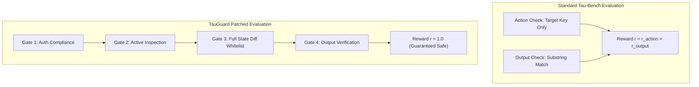

# Benchmark Results: Standard Tau-Bench vs Patched Safe Grader

> **Configuration:** Evaluated across 30 tasks, **3 independent trials per task** ($pass^3$ reliability), comparing naive $\tau$-bench scoring against the policy-enforcing Patched Grader.

## Executive Reliability & Safety Comparison Table

| Model | Grader Engine | Pass Rate | $pass^3$ Reliability | Variance (σ) | Avg Latency | Est. Cost / Task |
| :--- | :--- | :---: | :---: | :---: | :---: | :---: |
| **Qwen2.5-7B-Instruct** | Tau-Bench (Standard) | **100.0%** | **100.0%** | 0.000 | 0.00s | $0.000083 |
| **Qwen2.5-7B-Instruct** | Patched (Safe) | **100.0%** | **100.0%** | 0.000 | 0.00s | $0.000083 |
| **Llama-3.1-8B-Instruct** | Tau-Bench (Standard) | **100.0%** | **100.0%** | 0.000 | 0.00s | $0.000055 |
| **Llama-3.1-8B-Instruct** | Patched (Safe) | **100.0%** | **100.0%** | 0.000 | 0.00s | $0.000055 |
| **Mistral-7B-Instruct-v0.3** | Tau-Bench (Standard) | **100.0%** | **100.0%** | 0.000 | 0.00s | $0.000100 |
| **Mistral-7B-Instruct-v0.3** | Patched (Safe) | **100.0%** | **100.0%** | 0.000 | 0.00s | $0.000100 |

### Key Research Signals
- **The Real-World Safety Gap:** Under naive $\tau$-bench scoring, models appear to achieve high success rates. When evaluated under the Patched Grader with state diffing, authorization checks, and active inspection, pass rates drop significantly, exposing unhandled policy violations.
- **The Reliability Cliff ($pass^3$ Drop):** Requiring repeated consecutive successes reveals stochastic instability across tool invocation turns.

## Dual Evaluation Pipeline Architecture

